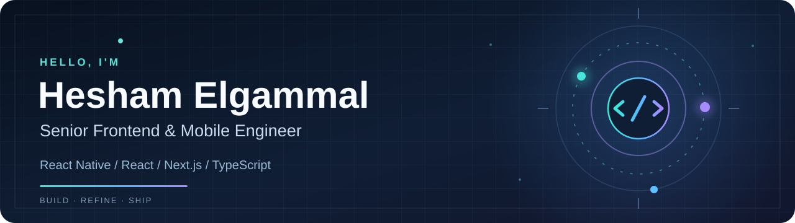

<div align="center">
  

  <br />

  <a href="https://heshamelgammal.vercel.app"></a>
  <a href="https://www.linkedin.com/in/hesham-el-gammal-3b47a0383"></a>
  <a href="mailto:heshamelgammal404@gmail.com"></a>

  <br /><br />

  **6 years building web and mobile experiences — from first screen to production.**

  *Egypt 🇪🇬 · Open to international opportunities*
</div>

---

### 👋 A little about me

I'm **Hesham**, a Senior Frontend & Mobile Engineer working across **React Native, React, Next.js, and TypeScript**. I enjoy turning complex product requirements into fast, approachable experiences that are easy for teams to maintain.

I'm currently at **Medica Scope**, working on **CarLink**, an automotive services platform for the Saudi market. Previously, I've worked on products with **Waseet.net**, **Digital Car**, and **O-Projects**.

What matters most to me isn't how many frameworks are on a résumé. It's building software that **works in production**, makes sense to its users, and stays understandable as it grows.

### 🛠️ The work I care about

<table>
<tr>
<td width="50%" valign="top">

**📱 Mobile, done thoughtfully**

React Native apps, navigation, authentication, native integrations, responsiveness, release workflows, and the details users actually notice.

</td>
<td width="50%" valign="top">

**🌐 Web that feels fast**

React and Next.js applications, thoughtful rendering, reliable API integration, caching, and performance across real-world devices.

</td>
</tr>
<tr>
<td valign="top">

**🧩 Architecture & design systems**

Reusable components, clear feature boundaries, shared tokens, maintainable state, and consistent experiences across platforms.

</td>
<td valign="top">

**🚀 Shipping with confidence**

Code reviews, debugging, CI/CD, production releases, and AI-assisted workflows where the engineer still owns the decisions.

</td>
</tr>
</table>

### ✨ Selected product work

| Product | My focus |
| :-- | :-- |
| **CarLink** · Medica Scope | Automotive services; mobile and web experiences, booking flows, dashboards, API integration |
| **Waseet.net** | Classifieds experiences across web and mobile |
| **Digital Car** | Automotive journeys for the Saudi market; customer and retailer workflows |
| **Maysan Jobs** | React Native job marketplace application |
| **TeeslaTech** | E-commerce storefront and administration experience |

> Some of the products I've worked on are company-owned and their source code isn't public. This profile highlights my public work alongside that professional experience.

### ⚙️ Toolkit

<div align="center">
  
</div>

**Mobile:** React Native · iOS & Android · native integrations

**App architecture:** TanStack Query · Redux Toolkit · Zustand · React Navigation · reusable UI systems

**Delivery:** Git · GitHub · GitLab · Firebase · CI/CD · Figma · Sentry

**Also worked with:** Node.js · Express · MongoDB

### 🔭 From my public repositories

<table>
<tr>
<td width="50%" valign="top">

**[React Native Starter (RNSRC)](https://github.com/HeshamElgammal/RNSRC)**

A reusable React Native foundation with TypeScript, navigation, authentication patterns, theming, and secure storage.

</td>
<td width="50%" valign="top">

**[Portfolio Website](https://github.com/HeshamElgammal/new-portfolio)**

My personal website built with Next.js, TypeScript, and Tailwind CSS.

[Visit live website](https://heshamelgammal.vercel.app)

</td>
</tr>
</table>

### 🧠 My engineering mindset

```text
Understand the problem
        ↓
Design for real users
        ↓
Keep the architecture clear
        ↓
Build, measure, and review
        ↓
Ship → learn → improve
```

> **AI can help write code. Engineers remain responsible for the software they ship.**

I use AI to explore ideas, speed up repetitive tasks, and support code reviews — always with a focus on verification, architecture, and product quality.

---

<div align="center">
  <b>Have a product, an engineering challenge, or an opportunity in mind?</b>
  <br /><br />
  <a href="mailto:heshamelgammal404@gmail.com">Let's talk</a> · <a href="https://heshamelgammal.vercel.app">Portfolio</a> · <a href="https://www.linkedin.com/in/hesham-el-gammal-3b47a0383">LinkedIn</a>
  <br /><br />
  <sub>Built with curiosity. Refined with care.</sub>
</div>
